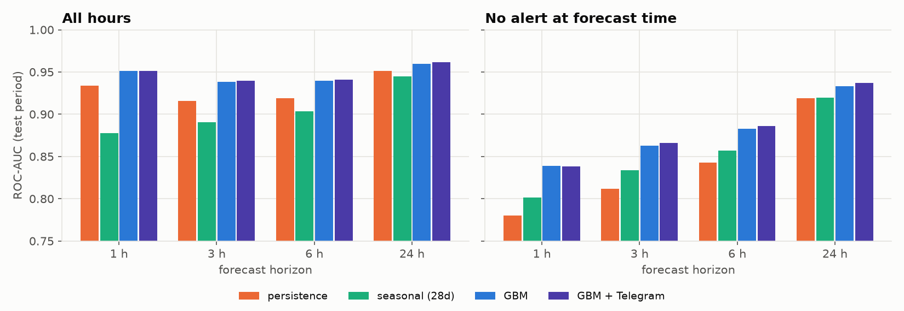
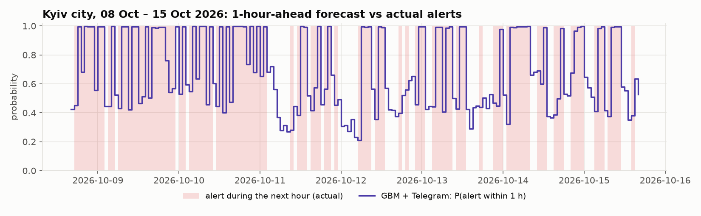

# Air-raid alert forecasting for Ukraine

For every **raion** of Ukraine (and Kyiv city separately), predict the probability that an air-raid alert will be active **at some point during the next 1, 3, 6 or 24 hours**. The inputs are the alert history and the text of public Telegram channels (Air Force of Ukraine `kpszsu`, `war_monitor`). Everything is strictly limited to information published before the forecast time.

KSE AI Agentic School, Stage 2. Built with Claude Code as the primary engineering tool; the full AI log is submitted separately.

**Bottom line:** on the newest month (2026-09-16 → 10-15, a period of sharp escalation), the model beats persistence and seasonal baselines at every horizon. For predicting a *new* alert within the next hour, its ROC-AUC is 0.84 vs 0.78 for persistence.

## Results

Two raion-level tests, both on the most recent data available at the time:

| Test | Period | Alert data | Units |
|---|---|---|---|
| **Fresh** | 2026-09-16 → 2026-10-15 14:00 UTC | official alerts via the alerts.in.ua API | 119 (118 raions + Kyiv city) |
| **August** | 2026-08-10 → 2026-09-07 | official GitHub dataset | 119 |

Both use walk-forward evaluation: the model is retrained every week on all rows whose targets were fully observed before that week starts. ROC-AUC / Brier score on the test period:

### Fresh test, 2026-09-16 → 2026-10-15 (raion level)

| subset | H | persistence AUC / Brier | seasonal AUC / Brier | GBM AUC / Brier | GBM + Telegram AUC / Brier |
|---|---|---|---|---|---|
| all | 1 h | 0.934 / 0.099 | 0.878 / 0.145 | **0.951** / **0.081** | 0.951 / 0.081 |
| quiet_now | 1 h | 0.780 / 0.141 | 0.802 / 0.135 | **0.839** / **0.116** | 0.838 / 0.116 |
| all | 3 h | 0.916 / 0.136 | 0.890 / 0.140 | 0.938 / 0.101 | **0.940** / **0.099** |
| quiet_now | 3 h | 0.812 / 0.196 | 0.834 / 0.160 | 0.863 / 0.145 | **0.866** / **0.143** |
| all | 6 h | 0.919 / 0.138 | 0.904 / 0.126 | 0.939 / 0.098 | **0.941** / **0.097** |
| quiet_now | 6 h | 0.843 / 0.200 | 0.857 / 0.157 | 0.883 / 0.142 | **0.886** / **0.140** |
| all | 24 h | 0.951 / 0.099 | 0.945 / 0.082 | 0.959 / 0.078 | **0.962** / **0.070** |
| quiet_now | 24 h | 0.919 / 0.143 | 0.919 / 0.112 | 0.933 / 0.112 | **0.937** / **0.101** |

Base rate of the target: 1 h: 0.44, 3 h: 0.55, 6 h: 0.64, 24 h: 0.78. **Bold** = best in the row.




### August test, 2026-08-10 → 2026-09-07 (raion level)

| subset | H | persistence AUC / Brier | seasonal AUC / Brier | GBM AUC / Brier | GBM + Telegram AUC / Brier |
|---|---|---|---|---|---|
| all | 1 h | 0.957 / 0.063 | 0.903 / 0.114 | **0.968** / **0.057** | 0.967 / 0.058 |
| quiet_now | 1 h | 0.831 / 0.082 | 0.827 / 0.102 | **0.876** / **0.075** | 0.872 / 0.076 |
| all | 3 h | 0.937 / 0.096 | 0.904 / 0.125 | **0.952** / **0.085** | 0.951 / 0.086 |
| quiet_now | 3 h | 0.846 / 0.128 | 0.844 / 0.141 | **0.882** / **0.113** | 0.881 / 0.114 |
| all | 6 h | 0.932 / 0.107 | 0.909 / 0.124 | **0.951** / **0.089** | 0.946 / 0.095 |
| quiet_now | 6 h | 0.861 / 0.142 | 0.861 / 0.152 | **0.901** / **0.118** | 0.890 / 0.126 |
| all | 24 h | 0.933 / 0.103 | 0.917 / 0.103 | **0.942** / **0.093** | 0.938 / 0.095 |
| quiet_now | 24 h | 0.888 / 0.137 | 0.890 / 0.136 | **0.902** / **0.124** | 0.896 / 0.126 |

Base rate of the target: 1 h: 0.33, 3 h: 0.42, 6 h: 0.49, 24 h: 0.62. **Bold** = best in the row.

### Robustness check: oblast level, 2026-09-13 → 2026-10-12

Same pipeline on a third-party export of the official alerts, which only has oblast-level data (see *Data*). 24 units.

| subset | H | persistence AUC / Brier | seasonal AUC / Brier | GBM AUC / Brier | GBM + Telegram AUC / Brier |
|---|---|---|---|---|---|
| all | 1 h | 0.953 / 0.107 | 0.897 / 0.138 | 0.959 / 0.080 | **0.960** / **0.079** |
| quiet_now | 1 h | 0.827 / 0.179 | 0.821 / 0.146 | 0.851 / 0.133 | **0.854** / **0.131** |
| all | 3 h | 0.948 / 0.132 | 0.915 / 0.123 | 0.952 / 0.086 | **0.955** / **0.083** |
| quiet_now | 3 h | 0.865 / 0.225 | 0.856 / 0.158 | 0.879 / 0.144 | **0.885** / **0.140** |
| all | 6 h | 0.953 / 0.131 | 0.930 / 0.111 | 0.954 / 0.082 | **0.956** / **0.079** |
| quiet_now | 6 h | 0.893 / 0.224 | 0.879 / 0.155 | 0.897 / 0.140 | **0.901** / **0.135** |
| all | 24 h | **0.960** / 0.107 | 0.942 / 0.093 | 0.940 / 0.084 | 0.944 / **0.076** |
| quiet_now | 24 h | **0.927** / 0.184 | 0.899 / 0.146 | 0.885 / 0.143 | 0.893 / **0.129** |

Base rate of the target: 1 h: 0.56, 3 h: 0.67, 6 h: 0.74, 24 h: 0.85. **Bold** = best in the row.

How to read the numbers:
* **persistence** = P(alert | unit, alert active now); **seasonal** = P(alert | unit, hour of day) over the last 28 days. Both are estimated on the training data.
* **quiet_now** = only the hours with no alert at forecast time. Here the task is to predict a *new* alert, which is the useful and hard part. On all hours, "an alert is on now" alone already gives a high AUC.

### What the results say

* **GBM beats both baselines** at every horizon in both raion-level tests, on AUC and Brier. The largest gain is in the hard "quiet now" subset (fresh test, 1 h: AUC 0.839 vs 0.780 / 0.802).
* **The Telegram features help a little, but only in the fresh period.** In Sep–Oct (escalation, base rates +30–50% vs August), GBM + Telegram is the best model at 3, 6 and 24 h in both fresh tests (e.g. Brier at 24 h 0.070 vs 0.078). In August it is slightly *worse* than GBM without text. The effect is small either way. Keyword features at oblast level cannot say *which* raion a drone is heading to.
* **24-hour probabilities are too low in the fresh period**: predicted 0.15 → observed 0.42 (`reports/raion_fresh/results_calibration.png`). The model learned base rates in a calmer period. The ranking (AUC) holds up, but the probabilities need recalibration under a regime shift. 1-hour forecasts stay well calibrated.
* On the oblast-level check at 24 h, persistence has the best AUC. That target is almost saturated (base rate 0.85), and the model still needs to "warm up" after the 7–12 Sep data gap (see *Limitations*).

## Problem formulation

* **Unit**: a raion with at least 20 raion-level alerts since 2025-11-01 (118 raions), plus Kyiv city. A raion is *under alert* when its own raion-level alert **or** an oblast-level alert of its oblast is active. Hromada-level alerts cover only part of a raion, so they are a feature and not part of the target. *(Defining the unit as "the whole oblast" was tried first. It makes frontline oblasts 90–100% "under alert", which is uninformative.)*
* **Forecast time** `t`: every full hour. **Target** `y_H(t)`: any minute under alert in `[t, t+H)`, for H ∈ {1, 3, 6, 24}.
* **Model**: `sklearn.HistGradientBoostingClassifier`, one global model per horizon over all units (unit and oblast as categorical features). LightGBM was the first choice, but on macOS it needs a system `libomp`. HistGB is the same algorithm family with zero extra setup for anyone running the repo.

## Data

| Source | Period used | Notes |
|---|---|---|
| [Vadimkin/ukrainian-air-raid-sirens-dataset](https://github.com/Vadimkin/ukrainian-air-raid-sirens-dataset), `official_data_uk.csv` | 2025-11-01 → 2026-09-07 | Official alerts with oblast/raion/hromada level. **Updates stopped on 2026-09-07**, the same moment its upstream Telegram channel `air_alert_ua` went silent. |
| [alerts.in.ua API](https://devs.alerts.in.ua), `/v1/regions/{uid}/alerts/month_ago.json` for every oblast (cached in `data/raw/alerts_in_ua/`) | 2026-09-16 → 2026-10-15 | Official alerts with raion/hromada level and `alert_level` (yellow/red). Only the last month is available, so the cache is committed. |
| Third-party export of the official alerts, flattened to oblast level (`data/raw/friend/alerts.csv`) | 2026-09-13 → 2026-10-12 | **Verified** against the GitHub CSV: in Aug 2026 all 8,471 records match an official record exactly (oblast, start and end to the second). It is the union of all levels per oblast, with no raion info. |
| Telegram `kpszsu` (Air Force), `war_monitor` | 2025-10-25 → 2026-10-15 | Scraped from the public `t.me/s/` web preview. |

Data findings that shaped the design:
* **Regime change in Nov 2025**: alerts moved from oblast level to raion level (`reports/eda_levels_by_month.png`). Training starts on 2025-11-01, so the history has one consistent meaning.
* **38% of the rows in the official CSV are exact duplicates** (113,845 of 299,275). They are deduplicated on (oblast, raion, hromada, level, start minute).
* **The API differs from its own docs**: raion alerts carry the raion name in `location_title` (there is no `location_raion`), and every `city` alert duplicates its hromada's alert to the minute (all 1,078), so `city` rows are dropped. Three raions were renamed since the GitHub dataset was built (Володимир-Волинський → Володимирський, Красноградський → Берестинський, Червоноградський → Шептицький) and are mapped explicitly. After the mapping every API raion matches a unit and every unit has API alerts. The union per oblast matches the third-party file (median Jaccard 0.997), and for Kyiv city it matches exactly.
* **Alert = yellow or red.** Since 2026-09-06 alerts have a level, and red is only 2.7% of the time in Kyiv. Both levels are counted, which matches the third-party file exactly and keeps the target comparable to the history.
* **2026-09-07 … 2026-09-15 is a gap at raion level** (…09-12 at oblast level). The official CSV ends there, and the third-party file is inaccurate in that window: it has 3–4× fewer records per day and a separate "Київ" region whose alerts all last exactly 30:00. On 2026-09-06 Kyiv also switched to a "differentiated alert system" (Glavcom, 2026-10-15).
* **Sep–Oct 2026 is a much more intense period.** In Kyiv city, time under alert went from 14.6% (Aug 10 – Sep 6) to 32.6% (Sep 13 – Oct 11). An independent source agrees: `war_monitor` posts mentioning Kyiv went from 10 to 38 per day. The median alert duration did not change (37 vs 34 min), so this is more alerts, not a format artefact.
* The CSV contains no alerts without `finished_at`, i.e. alerts active at snapshot time are missing. The last partial day is dropped, otherwise it would look artificially quiet.

## Leakage controls

* Features at `t` use alert minutes `< t` only. "Alert now" = minute `t−1`. Lags are complete hours before `t`.
* Telegram posts count only if `published_at < t`. **Edited posts are dropped**: the web preview shows the *current* text, which may contain information added after publication (1–2% of posts).
* Walk-forward split: a training row at `t` is used for a fold starting at `T` only if `t + H ≤ T`, so its target was fully observed before the fold starts.
* **Gaps** in alert data never turn into fake zeros. Rate features are computed over the known part of their window (NaN if less than half is known). Other features and all targets that touch a gap are NaN.
* `tests/test_leakage.py` corrupts all data from `T0` on, including a post published *exactly* at `T0`, and checks that no feature at `t ≤ T0` changes. The test was **mutation-checked**: re-introducing "Telegram window includes hour t", "alert-now reads minute t" or "targets not masked at gaps" makes it fail.

## Limitations

* No source covers 2026-09-07 … 09-15 at raion level, so the fresh test starts right after a 9-day gap. Long-window features are computed from the known part of their window. Before that fix (first version: NaN for the whole window), 24 h AUC on the oblast check was 0.916; after it, 0.940.
* After a data gap the model needs roughly 3 weeks before its 24-hour forecasts fully recover (oblast check: 24 h AUC below persistence in weeks 1–3, equal in week 4).
* **Calibration under the regime shift**: 24 h probabilities are too low in Sep–Oct. Recency-weighted training or online recalibration is the obvious next step.
* The 24-hour oblast-level target is almost saturated in Sep–Oct (base rate 0.85), so it says little.
* Telegram features use keyword and region regexes, not a language model. Mentions are mapped to oblasts, not raions.
* Possible concept drift from Kyiv's differentiated alert system after 2026-09-06 cannot be separated from the real escalation with the data available.

## How the model got here (iterations)

| Version | Change | Why |
|---|---|---|
| target v1 → v2 | oblast-wide alert → raion (own raion alert or oblast alert) | v1 was 90–100% "on" for frontline oblasts |
| data | dedup on (oblast, raion, **hromada**, level, minute) | the first key silently merged different hromadas |
| features v1 → v2 | + unit × time-of-day memory (`seas_*`) and 30-day rate | GBM lost to both baselines at 24 h (quiet-now AUC 0.883 vs 0.888 / 0.890) |
| gaps v1 → v2 | NaN for the whole window → rate over the known part | in the fresh test, 28- and 30-day features were NaN for the whole month after the gap (24 h AUC 0.916 → 0.940) |
| text v1 → v2 | raw post counts → shares / volume relative to the last 7 days | channels post 2–3× more in autumn; raw counts made the model *worse* |
| API adapter | raion name from `location_title`, drop duplicated `city` rows, snapshot time from JSON `meta` | real responses differ from the docs; file mtimes change on `git clone` |

Discarded results are kept in `reports/ablation/`.

## Refreshing data (optional)

```bash
.venv/bin/python -m src.telegram kpszsu          # resumable, checkpointed; --before/--stop-id/--part to parallelise
.venv/bin/python -m src.telegram war_monitor
echo "ALERTS_IN_UA_TOKEN=..." > .env              # git-ignored; never commit the token
rm -r data/raw/alerts_in_ua && .venv/bin/python -m src.alerts_in_ua   # last month, 2 requests/min
```

## How to run

All scraped and API data used for the results is committed, so the commands below reproduce them without network access (except the GitHub CSV, which is downloaded automatically).

```bash
python3 -m venv .venv && .venv/bin/pip install -r requirements.txt
.venv/bin/python main.py --sources sirens_csv alerts_in_ua --test-days 29 \
    --telegram kpszsu war_monitor --out raion_fresh                          # fresh test, Sep 16 – Oct 15
.venv/bin/python main.py --telegram kpszsu war_monitor                       # August test
.venv/bin/python main.py --level oblast --sources sirens_csv oblast_csv \
    --test-days 29 --telegram kpszsu war_monitor                             # oblast check, Sep 13 – Oct 12
for d in raion_fresh raion oblast; do .venv/bin/python -m src.report reports/$d; done
.venv/bin/python -m src.eda
.venv/bin/python -m pytest tests
```

## Repository layout

```
main.py              end-to-end: data -> features -> walk-forward backtest -> reports/<level>/
src/config.py        constants (history start, horizons, oblasts, known data gap)
src/data.py          alert sources -> one common frame -> [minute x unit] activity matrices
src/alerts_in_ua.py  alerts.in.ua API adapter (token via ALERTS_IN_UA_TOKEN, never committed)
src/telegram.py      resumable, checkpointed t.me/s/ scraper
src/features.py      hourly features & targets with gap handling
src/models.py        persistence / seasonal baselines, gradient boosting
src/evaluate.py      walk-forward folds and metrics
src/eda.py, src/report.py   plots
tests/test_leakage.py
```
